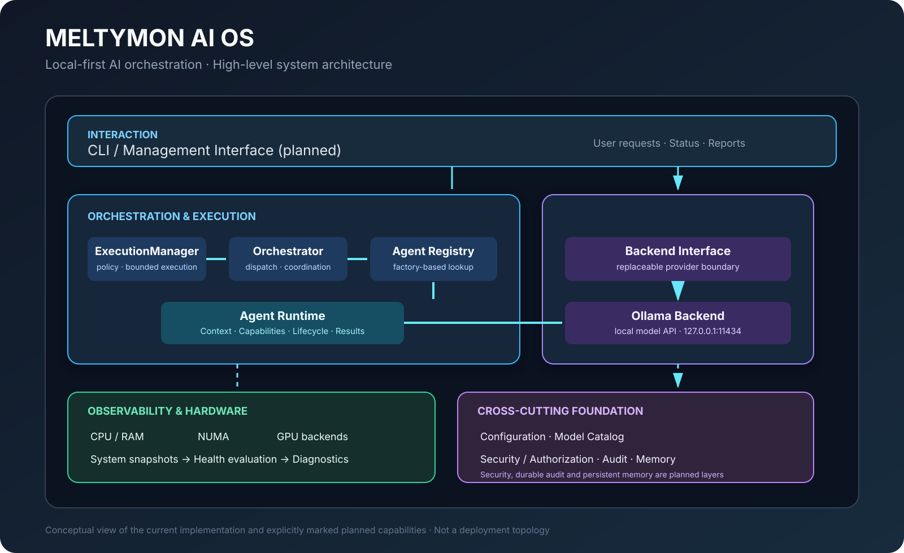

# MELTYMON AI OS

**A modular, local-first AI orchestration platform for Linux.**

MELTYMON AI OS is an open-source project focused on building a modular platform for running, monitoring, and eventually orchestrating local AI workloads.

The project aims to connect local AI models, hardware resources, monitoring, agents, memory, orchestration, and security in one coherent platform.

> **Project status:** Early development — Core infrastructure, Ollama integration, model management, hardware monitoring, health evaluation, diagnostics, Agent Runtime, Execution Layer, and initial agent orchestration are implemented. Full end-to-end integration is still in development. This is not yet a complete AI agent platform.

[Roadmap](ROADMAP.md) · [Project TODO](TODO.md) · [Changelog](CHANGELOG.md) · [Development History](docs/DEVELOPMENT.md) · [Contributing](CONTRIBUTING.md) · [License](LICENSE)

---

## Vision

The goal of MELTYMON AI OS is to provide a flexible foundation for local AI systems.

Instead of depending entirely on cloud-based AI services, the platform is designed to make local AI infrastructure easier to understand, monitor, extend, and operate.

The long-term vision is a modular AI environment that connects local models, hardware resources, agents, memory, orchestration, and security into one coherent system.

## Project Goals

- **Local-first:** Prioritize locally operated AI models and services.
- **Modular architecture:** Keep components independent and replaceable.
- **Hardware awareness:** Understand available CPU, memory, NUMA, and GPU resources.
- **Extensibility:** Make it possible to add new backends, monitoring providers, and agent capabilities.
- **Transparency:** Make system state, diagnostics, and resource usage observable.
- **Reliability:** Isolate component failures and validate system state.
- **Security:** Establish controlled execution and access boundaries.
- **Open development:** Build the platform collaboratively with the community.

---

## Current Features

The following components have an initial implementation in the current development version.

| Component | Current capabilities |
|---|---|
| Configuration | YAML-based settings, environment variable overrides, and validation |
| Ollama backend | Connection checks, model listing, model details, and text generation |
| Model catalog | Model discovery and metadata normalization |
| System resources | CPU and RAM monitoring |
| NUMA monitoring | NUMA topology, CPU lists, memory statistics, and distances |
| GPU architecture | Backend-based, multi-device monitoring |
| Intel GPU backend | Intel GPU detection and Linux sysfs telemetry |
| Health evaluation | Configurable system and device health checks |
| Diagnostics | Rule-based diagnostic findings and severity levels |
| Monitoring service | Integration of snapshots, health evaluation, and diagnostics |
| Monitoring API | Public interface for monitoring information |
| Serialization | Conversion of monitoring data into dictionaries and JSON |
| Agent Runtime | Agent base class, immutable context and results, capabilities, lifecycle, and structured failures |
| Execution Layer | Bounded concurrent execution, fail-fast policy, batch timeouts, and immutable reports |
| Orchestration | Factory-based agent registry and asynchronous dispatch |

### Hardware Monitoring

The monitoring subsystem is designed to collect information from multiple hardware components.

Current monitoring capabilities include:

- CPU utilization and system memory.
- NUMA topology and per-node memory information.
- GPU discovery and multi-GPU snapshot collection.
- Intel GPU telemetry through Linux sysfs interfaces.
- Device-specific health checks.
- Structured diagnostic information.
- Isolation of individual component and device errors.

GPU monitoring uses backend interfaces. The Intel implementation is currently available; NVIDIA and AMD backends are planned.

Not every telemetry field is available on every GPU or driver.

### Ollama Integration

MELTYMON AI OS provides an asynchronous backend for Ollama.

Implemented operations include:

- Checking the Ollama connection.
- Listing locally available models.
- Retrieving model details.
- Generating text.
- Normalizing model metadata through the model catalog.

The default Ollama endpoint is:

```text
http://127.0.0.1:11434
```

The backend is designed to communicate with a locally running Ollama service.

---

## Architecture

The project uses a modular Python package structure.

### Architecture at a glance

The diagrams below provide a visual overview of the documented implementation. They distinguish implemented components from planned capabilities.



- [Monitoring pipeline](docs/architecture/monitoring-pipeline.svg)
- [Agent execution flow](docs/architecture/agent-execution-flow.svg)
- [Architecture visuals and accuracy notes](docs/architecture/README.md)

```text
src/meltymon_ai_os/
├── agents/
│   ├── base.py
│   ├── capabilities.py
│   ├── context.py
│   ├── exceptions.py
│   ├── lifecycle.py
│   └── result.py
├── audit/
├── backends/
│   ├── base.py
│   └── ollama.py
├── config/
│   ├── settings.py
│   └── settings.yaml
├── execution/
│   ├── manager.py
│   ├── policy.py
│   └── report.py
├── memory/
├── models/
│   ├── catalog.py
│   └── metadata.py
├── monitoring/
│   ├── api.py
│   ├── diagnostics.py
│   ├── gpu.py
│   ├── gpu_intel.py
│   ├── health.py
│   ├── numa.py
│   ├── resources.py
│   ├── serialization.py
│   ├── service.py
│   └── system.py
├── orchestrator/
│   ├── engine.py
│   ├── exceptions.py
│   └── registry.py
├── security/
└── validation/
```

Some package directories are currently architectural scaffolding. Their presence does not mean that the corresponding functionality is already implemented.

### Monitoring Flow

```text
                 MonitoringService.collect()
                            │
                            ▼
System Resources ─┐    SystemMonitor
NUMA Monitor ──────┤         │
GPU Backends ──────┘         ▼
                      SystemSnapshot
                            │
                            ▼
                     HealthEvaluator
                            │
                            ▼
                       HealthReport
                            │
                            ▼
                     DiagnosticEngine
                            │
                            ▼
                     DiagnosticReport
                            │
                            ▼
                    MonitoringResult
```

The monitoring service combines collected system information with health assessments and diagnostic findings.

### Agent Execution Flow

```text
AgentContext
     │
     ▼
ExecutionManager ── ExecutionPolicy
     │
     ▼
Orchestrator
     │
     ▼
AgentRegistry ── Factory
     │
     ▼
AgentBase ── Lifecycle / Capabilities
     │
     ▼
AgentResult
     │
     ▼
ExecutionRecord / ExecutionReport
```

This is an initial execution foundation. Agent execution is not yet automatically connected to Ollama model selection, hardware-aware scheduling, monitoring feedback, persistent memory, or a platform-wide authorization service.

For more information, see the [Architecture Documentation](docs/ARCHITECTURE.md).

---

## Technology Stack

- Python 3.11+
- Async Python
- Ollama API
- Pydantic
- PyYAML
- HTTPX
- psutil
- Linux sysfs interfaces for hardware telemetry
- pytest for automated testing

Linux is the primary development target. Hardware telemetry depends on the available kernel interfaces, drivers, and device capabilities.

---

## Requirements

- Python 3.11 or newer.
- Linux for the current hardware monitoring implementation.
- Ollama for local model integration.
- Appropriate GPU drivers and kernel interfaces for GPU telemetry.

The monitoring components are designed to handle unavailable hardware interfaces without unnecessarily interrupting other monitoring operations.

---

## Installation

Clone the repository:

```fish
git clone https://github.com/meltymon/meltymon-ai-os.git
cd meltymon-ai-os
```

Create and activate a virtual environment:

```fish
python -m venv .venv
source .venv/bin/activate.fish
```

Install the project:

```fish
python -m pip install -e .
```

Install development and test dependencies:

```fish
python -m pip install -e ".[test]"
```


---

## Configuration

The application uses YAML-based configuration with environment variable overrides.

The default Ollama endpoint is:

```text
http://127.0.0.1:11434
```

Supported environment variables currently include:

| Variable | Purpose |
|---|---|
| `MELTYMON_OLLAMA_BASE_URL` | Ollama API endpoint |
| `MELTYMON_OLLAMA_TIMEOUT` | Ollama request timeout |
| `MELTYMON_DEFAULT_MODEL` | Default model selection |

Configuration defaults and validation are implemented in the `config` package.

---

## Testing

The project uses pytest, pytest-asyncio, and pytest-cov.

Run the complete test suite:

```fish
pytest -q
```

Run a specific test module:

```fish
pytest -q tests/test_monitoring_service.py
```

Run tests with coverage:

```fish
pytest --cov=meltymon_ai_os --cov-report=term-missing
```

Before submitting changes, also check the patch for whitespace errors:

```fish
git diff --check
```

The latest documented test run for Milestone 10 (November 5, 2026) reports **491 passed**, with 96.79% statement coverage and 91.50% branch coverage. The earlier 133-test baseline from November 2 is historical. These results are snapshots, not a release certification.

See the [Testing Strategy](docs/TESTING.md) for more information.

---

## Documentation

The project documentation is organized into architecture, development history, testing, architectural decisions, and implementation milestones.

### Main Documentation

| Document | Description |
|---|---|
| [Architecture](docs/ARCHITECTURE.md) | System structure, components, and data flow |
| [Development History](docs/DEVELOPMENT.md) | Implementation history and development progress |
| [Testing Strategy](docs/TESTING.md) | Test organization, quality assurance, and validation |
| [Milestone 10 – Major Update and Quality Review](docs/milestones/10-major-update-agent-runtime-bugfixing-quality-review.md) | Agent Runtime, Execution Layer, orchestration, stabilization, and quality review |
| [Roadmap](ROADMAP.md) | Long-term development direction and planned features |
| [Project TODO](TODO.md) | Prioritized actionable tasks, dependencies, and acceptance criteria |
| [Changelog](CHANGELOG.md) | Project changes and development history |
| [Contributing](CONTRIBUTING.md) | Contribution guidelines |
| [License](LICENSE) | Apache License 2.0 |

### Architecture Decision Records

Architecture Decision Records document important technical decisions and their reasoning.

- [ADR 0001 – Modular Architecture](docs/adr/0001-modular-architecture.md)
- [ADR 0002 – Multi-GPU Monitoring](docs/adr/0002-multi-gpu-monitoring.md)
- [ADR 0003 – Monitoring Error Isolation](docs/adr/0003-monitoring-error-isolation.md)

### Implementation Milestones

The files below are topic-oriented implementation documents. Their numbering groups documentation areas and is not the chronological milestone sequence in [Development History](docs/DEVELOPMENT.md). For the chronological project timeline and commit references, use the Development History; Milestone 10 is the shared major Agent Runtime and quality milestone.

1. [Milestone 01 – Core Infrastructure](docs/milestones/01-core.md)
2. [Milestone 02 – Model Management](docs/milestones/02-model-management.md)
3. [Milestone 03 – Ollama Integration](docs/milestones/03-ollama-integration.md)
4. [Milestone 04 – Hardware Monitoring](docs/milestones/04-hardware-monitoring.md)
5. [Milestone 05 – Health and Diagnostics](docs/milestones/05-health-and-diagnostics.md)
6. [Milestone 06 – Testing and Quality](docs/milestones/06-testing-and-quality.md)
7. [Milestone 10 – Major Update, Agent Runtime, Orchestration and Quality Review](docs/milestones/10-major-update-agent-runtime-bugfixing-quality-review.md)

---

## Roadmap

MELTYMON AI OS is a long-term project. Development is organized into incremental phases.

The roadmap describes the intended direction, priorities, and planned functionality. It is not a fixed delivery schedule.

See **[ROADMAP.md](ROADMAP.md)** for the complete development plan and current implementation status.

Future development areas include:

- Additional AI backend integrations.
- NVIDIA and AMD GPU monitoring.
- End-to-end integration of Agent Runtime, Ollama, model catalog, and monitoring.
- Resource-aware model selection and workload scheduling.
- Agent-to-agent coordination and task planning.
- Persistent memory and context management.
- Enforced authorization, approval workflows, and durable auditing.
- Management interfaces and monitoring dashboards.
- Integration, performance, failure-recovery, and compatibility testing.

---

## Contributing

Contributions, ideas, bug reports, and constructive feedback are welcome.

The project is in an early development stage, so architecture and interfaces may still change.

Please read [CONTRIBUTING.md](CONTRIBUTING.md) before submitting changes.

---

## License

MELTYMON AI OS is licensed under the Apache License, Version 2.0.

You may use, modify, and distribute the project under the terms of that license.

See the [LICENSE](LICENSE) file for the complete license text.

---

## Project Status

MELTYMON AI OS is being developed as an independent open-source project.

The current implementation includes the core infrastructure, local Ollama integration, hardware monitoring, health evaluation, diagnostics, Agent Runtime, Execution Layer, and initial orchestration. The next focus is integration and stabilization; persistent memory, enforced security, and a management interface remain future work.

The goal is to build this step by step, with a strong emphasis on modularity, transparency, reliability, and long-term maintainability.
