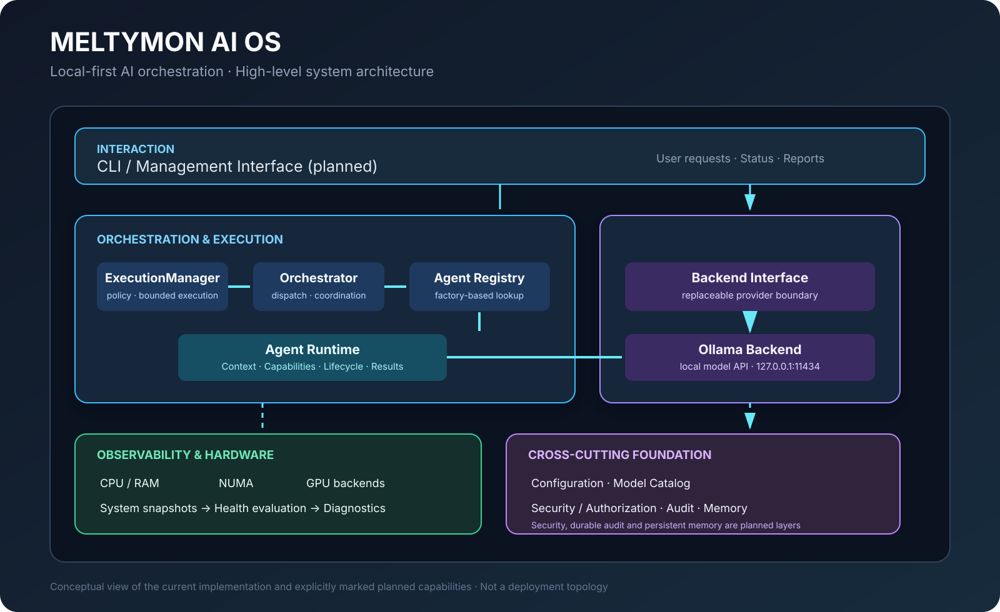
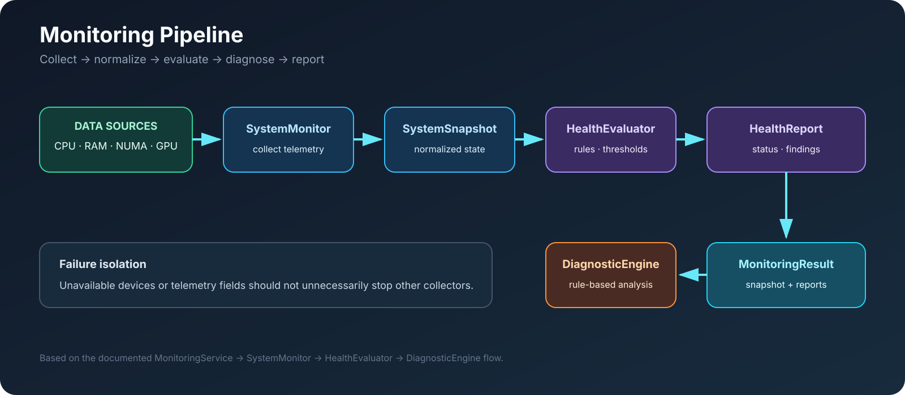
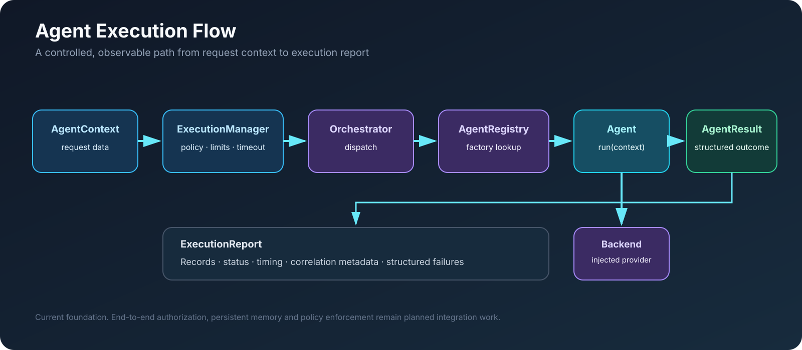

# Architecture Visuals

This directory contains source-controlled SVG diagrams for MELTYMON AI OS.

All diagrams are intentionally authored as SVG so they remain sharp at any display size, can be reviewed in Git, and can be edited without a raster graphics tool.

## System architecture

High-level view of the current platform boundaries. Planned capabilities are explicitly marked and should not be read as implemented components.

## Monitoring pipeline

Shows the documented collection, health evaluation, diagnostics, and reporting sequence.

## Agent execution flow

Shows the current context-to-result execution path, including the injected backend boundary and execution report.

## Accuracy notes

These are explanatory architecture diagrams, not deployment diagrams. They represent the documented implementation state at the time they were added. In particular, the management interface, persistent memory, platform-wide authorization, and durable audit capabilities are not represented as completed functionality.
